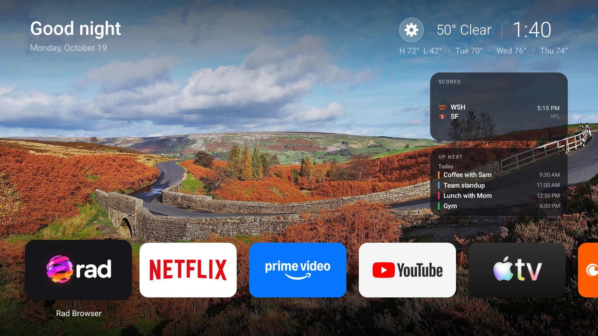
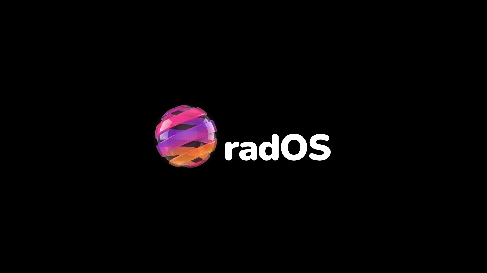
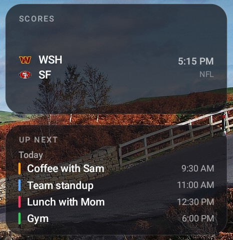
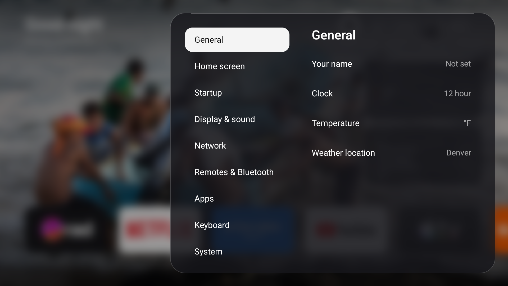
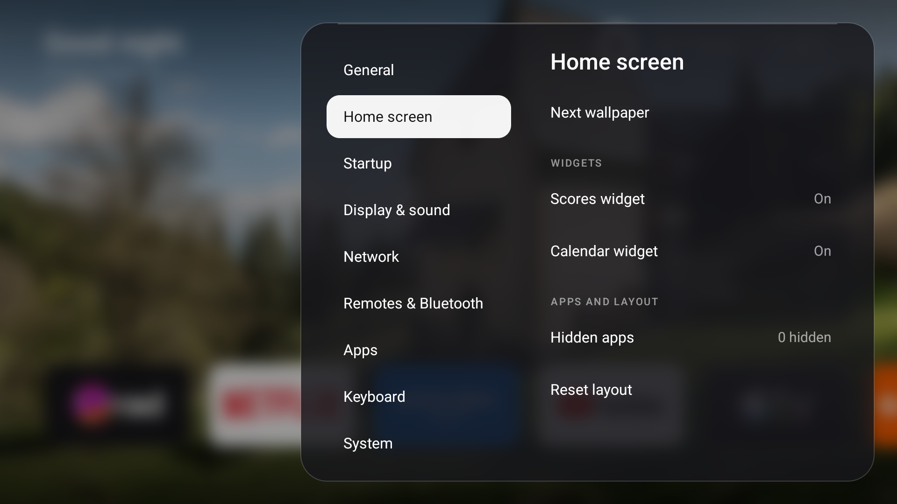
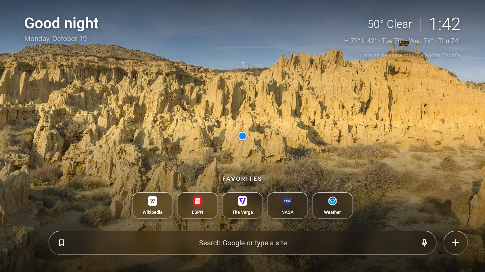
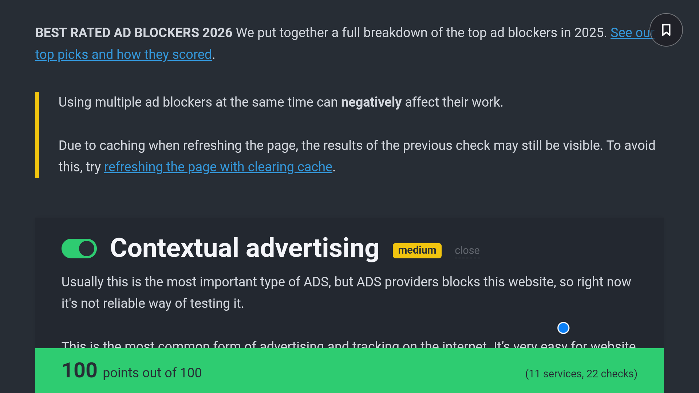
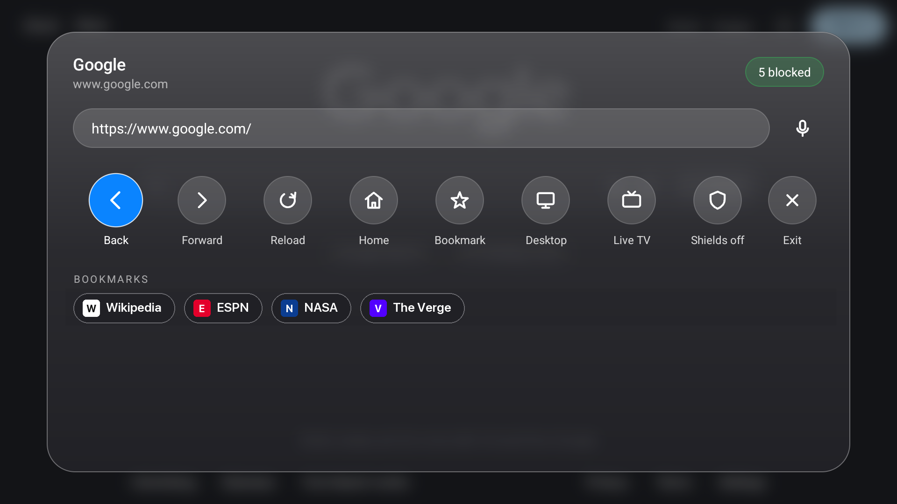
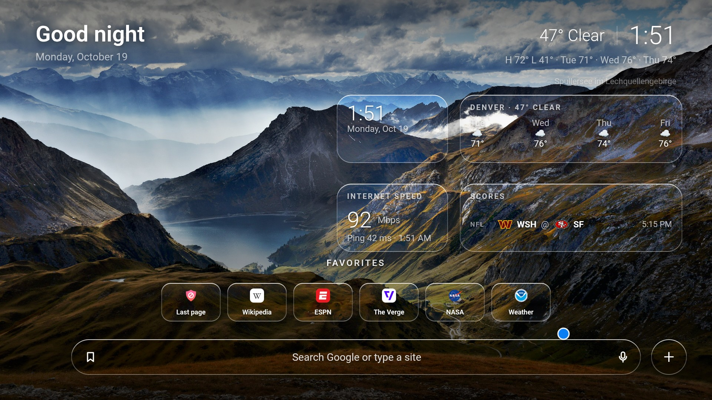
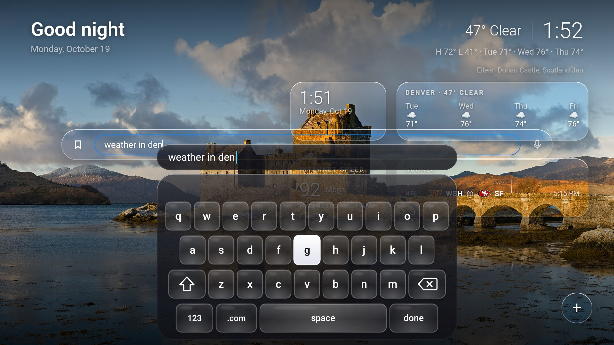

# radOS

**The whole TV, rebuilt.** A fast, ad free, fully customizable home screen, web browser and keyboard for Android TV and Google TV boxes. No accounts, no analytics, no preinstalled junk. Open source.



radOS takes over everything you see on a TV box, from the first second after power on. It is four parts that work as one system, all built for the remote control.

| Part | What it does |
|---|---|
| **Boot screen** | A short animation and chime when the box starts, instead of Android's blank screen. |
| **Home screen** | Greeting, clock and weather, live scores, your calendar, a rotating photo, one row of apps, and its own Settings. |
| **Rad Browser** | A fast web browser made for a remote, with the Rad Shield ad blocker built in. No trackers, no ads, no bloat. |
| **Glass Keys** | An onscreen keyboard for the whole TV, with suggestions and autocorrect. |

## What it does for you

**Quicker.** On our box (an onn 4K Pro with 3 GB of memory) Google's home screen process was holding about 295 MB when we measured it. The radOS home screen holds about 98 MB. Pressing Home opens radOS directly, before Google's launcher gets a turn. It paints the last scores, weather, calendar and photo from storage before it touches the network, so it never opens empty. Power on to the radOS home takes about 26 seconds. [How we measured each number.](docs/how_it_works.md#measurements)

**No bloat.** radOS shows no ads, no promoted rows and no recommendations feed, and it never asks for an account. [Remove the bloat](docs/debloat.md) lists the 16 preinstalled apps we cleared off our box and how to put any of them back.

**Fully yours.** Every line is here to read and change. Set your city, calendars and photos in one small file, move any app or card around with the remote, add widgets, or change what the code does. See [Customize](docs/customize.md).

**Private.** Nothing here sends your data to us, because there is no server of ours. The apps talk only to the services listed in [What it talks to](docs/how_it_works.md#what-it-talks-to).

## The boot screen



When the box starts, radOS shows a spinning glass globe, its name and a chime, in the seconds Android would otherwise show a black screen. It runs about six and a half seconds, and the home screen is already loading behind it.

## The home screen



- **Greeting, date, clock and weather**, with your name, today's high and low and the next few days.
- **Scores.** Today's NFL, NBA, MLB and NHL games, plus college football games that are live or have a top 25 team, on a wheel that turns one game at a time. Live games come first, and it refreshes every minute.
- **Up Next.** Your next events from any calendar link (Apple, Google, Outlook and others), with simple daily, weekly, monthly and yearly repeats worked out for the next two weeks.
- **A rotating photo** fills the screen, a new one every ten seconds, from Wikimedia Commons featured landscapes or from your own folder.
- **One row of apps.** Streaming apps first, the Play Store and Settings last, everything else in between. Hold OK on an app, the scores or the Up Next card to move it, and radOS remembers your order.

## Settings



The gear next to the weather opens Settings, all in one glass panel you drive with the remote.

| Section | What you can change |
|---|---|
| General | Your name for the greeting, 12 or 24 hour clock, °F or °C, weather location |
| Home screen | Next wallpaper, the scores and calendar cards on or off, hidden apps, reset the layout |
| Startup | The chime volume |
| Display & sound | Screensaver and sleep timers, surround sound, resolution and HDR |
| Network | Connection, address, link speed, a speed test, wifi settings |
| Remotes & Bluetooth | Pair a remote or headphones, TV control over HDMI |
| Apps | Info for every installed app |
| Keyboard | Glass Keys |
| System | Model, Android and radOS versions, storage, memory, up time, date, time and language |



## Rad Browser



A browser built for a remote and nothing else. It ships with zero bloat: no accounts, no analytics, no ads and no trackers, and the whole app is 362 KB. Arrow keys move a small pointer that speeds up while held and scrolls the page at the screen edge. OK clicks. Back, or holding OK, opens the menu. On the start page, holding OK on a widget opens its options. The mic button searches by voice.

### Rad Shield, the ad blocker



Rad Shield is the heart of Rad Browser. **On the public AdBlock Tester (adblock-tester.com) it scored 100 out of 100, blocking all 11 ad and tracking services in all 22 checks**, run on our TV on October 19, 2026. It reads the same public filter lists that uBlock Origin uses: EasyList, EasyPrivacy, uBlock filters, uBlock privacy filters and Peter Lowe's list. That is 145,896 rules, loaded in about a fifth of a second in our test.

- **Ads and trackers** are stopped before they download.
- **Leftover ad boxes** are hidden with element hiding rules.
- **Popups and redirect hijacks** are blocked, so a click does not open an ad.
- **A live counter** in the bar shows how many requests were blocked on this page.
- **Fast.** About 0.19 milliseconds to decide each request in our test, so pages do not wait on it.
- **Per site switch.** Open the Back menu and turn Shields off for one site if it breaks.
- **Fresh lists.** They download on the box and refresh every four days.

Run the test yourself with `sh browser/tests/run.sh`. It checks 14 cases (seven ad and tracker requests that must be blocked, seven normal requests that must be allowed) and times the matcher.

### The Back menu



Back opens a glass sheet over a blurred copy of the page with the address bar, the main actions and your bookmarks. Back again closes it.

### Widgets



Clock, weather, scores, calendar, countdown, photo, note and a speed test. Each has three sizes and five styles, and you place them anywhere with the remote.

## Glass Keys



An onscreen keyboard for the whole TV. Arrows move between keys, OK types, and holding OK on a letter types a capital. A strip on top shows what you are typing, and about 30,000 words power the suggestions and autocorrect. Delete right after an autocorrect puts back what you typed.

## Install

You need a Mac (Linux should work too, but we have not tried it) with JDK 17 and the Android SDK build tools, and a TV box with developer options on. The short version, with the full steps in [Install](docs/install.md):

```sh
adb connect 192.168.1.50:5555
TV=192.168.1.50:5555 sh home/build.sh install
TV=192.168.1.50:5555 sh browser/build.sh install
TV=192.168.1.50:5555 sh keys/build.sh install
```

Then turn on the Home screen helper in Accessibility, set Glass Keys as the keyboard, and press Home.

## Tested on

An onn 4K Pro Streaming Device with Google TV on Android 14. Other Android TV and Google TV boxes running Android 12 or newer should work, but we have not tried them. Removing Google's own launcher is optional, risky, and described in [Remove the bloat](docs/debloat.md).

## Credits and licenses

radOS is MIT licensed. See [LICENSE](LICENSE). The font, the word list and the services it uses have their own terms, listed in [THIRD_PARTY.md](THIRD_PARTY.md). radOS is not affiliated with Google, ESPN, Wikimedia, Apple or any other company named here.
